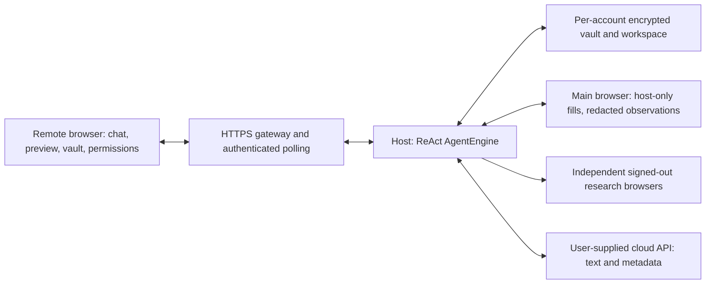

# Hosted Mode Architecture and Operator Guide

Auto-Mate supports a dedicated **Hosted Mode** alongside its local desktop workflow. In hosted mode, the browser automation engine, ReAct agent loop, and encrypted user vaults run on an operator's Windows host machine (or container), while remote users interact securely through an HTTPS web interface from any desktop or mobile browser.

This document describes the hosted architecture, operator workflow, cryptographic storage model, session management, network security controls, and trust boundaries.

---

## 1. Architecture Overview



### Key Distinctions: Local Mode vs. Hosted Mode

| Dimension | Local Desktop Mode (`bun start` / `Auto-Mate.exe`) | Hosted Mode (`bun run host` / `Auto-Mate.exe --hosted`) |
| :--- | :--- | :--- |
| **User Interface** | Local Chromium window launched on the desktop | HTTPS web interface accessed remotely via browser (two-column desktop layout, stacked on mobile) |
| **Authentication** | Native Windows Hello (biometrics / PIN) via DPAPI | Username (lowercase) + passphrase (≥12 chars) via scrypt / AES-256-GCM |
| **Registration** | Single local Windows user profile | Multi-account registration; open by default (no operator code required; optional invite key ≥16 chars) |
| **Model Endpoints** | Genuine local loopback (`localhost`, `127.0.0.1`, `::1`) or cloud HTTPS | Cloud HTTPS only; local loopback forbidden (`LOCAL_MODEL_FORBIDDEN_IN_HOSTED`) |
| **Browser Execution** | Local desktop Chromium | Headless/managed Chromium on the host machine |
| **Network Presence** | Local machine IP | Host machine IP (target websites see host IP) |
| **Trust Model** | Local DPAPI v2 protected by Windows Hello | Hosted scrypt + AES-256-GCM; host operator can access active process memory (not zero-knowledge) |
| **Permissions** | Native Windows Hello for vault reads; modal confirmations | Task-scoped variable grants / group grants; modal confirmations for buttons & sensitive actions |

---

## 2. Operator Guide

### Running Hosted Mode

From the extracted portable package:
```powershell
.\Auto-Mate.exe --hosted
```

Or from repository source (requires Bun 1.4.4+):
```powershell
bun run host
```

> **Important Operator Rules:**
> 1. **Keep the host machine and terminal awake.** Sleep, suspension, or closing a laptop lid interrupts network tunnels and user sessions, pausing execution (active tunnel connections and client heartbeats will drop).
> 2. **No Windows Firewall modifications needed.** Cloudflare QuickTunnel establishes an outbound tunnel to Cloudflare edge nodes; no inbound port forwarding or firewall rule widening is required.
> 3. **No local GPU or model setup needed.** The host runs the automation engine and communicates with user-configured external OpenAI-compatible APIs over HTTPS.
> 4. **Persistent disk and backups required.** Account vaults and workspaces are persisted on disk (`%LOCALAPPDATA%\AutoMate\hosted` or `/data`). Operators must ensure regular backups and persistent volume mounting.

### Container deployment boundary

- The container runs as non-root `bun` (uid 1000). Mount persistent storage at `/data` with ownership writable by that uid; ephemeral free-tier storage loses accounts and encrypted workspaces on replacement.
- Chromium sandboxing stays enabled. The host must permit Chromium's user namespaces; do not work around an incompatible platform by silently disabling the sandbox.
- Configure the public HTTPS origin and port using the variables below. `/healthz` returns 503 until origin activation, then 200 with only `{"status":"ready"}`; it accepts platform probe Host headers but does not relax application/auth Host checks.
- A healthy HTTP server does **not** prove browser startup or model availability. Exercise registration, a real task, and persistence after restart on the target provider.
- Linux container execution has not been verified on this Windows workstation; the Docker daemon is unavailable. The exercised public prototype is operator-hosted on Windows, not a claimed Railway/Render deployment.

### Configuration Environment Variables

Configuration is handled via environment variables:

| Environment Variable | Default | Purpose |
| :--- | :--- | :--- |
| `AUTOMATE_HOSTED_PUBLIC_ORIGIN` | *(unset)* | When set (e.g. `https://automate.example.com`), uses this HTTPS reverse-proxy origin and disables QuickTunnel. When unset, starts an ephemeral Cloudflare QuickTunnel. |
| `AUTOMATE_HOSTED_PORT` | `0` (ephemeral) | Local HTTP listening port on `127.0.0.1`. When using an existing reverse proxy, set this to your proxy's target backend port. |
| `AUTOMATE_HOSTED_DATA_DIR` | `%LOCALAPPDATA%\AutoMate\hosted` | Directory for account metadata, encrypted user vaults, workspace settings, and audit journals. |
| `AUTOMATE_HOSTED_REGISTRATION_KEY` | *(unset)* | Optional operator registration invite code (minimum 16 characters). When unset or empty, registration is **open** (no operator code needed). |

### Pinned Cloudflare Tunnel Helper

When `AUTOMATE_HOSTED_PUBLIC_ORIGIN` is unset, Auto-Mate manages an ephemeral Cloudflare QuickTunnel:
- Official binary: `cloudflared-windows-amd64.exe` (release `2026.10.7`).
- Cryptographic SHA-256 fingerprint: `2493dbc168923bb3e59e5e7716f71deced92992eea9acd6e9d74f84ac7751343` (file size: 55,390,512 bytes).
- Download cache: Verified and cached in `%LOCALAPPDATA%\AutoMate\tools\cloudflared-2026.10.7-amd64.exe`.
- Corrupt or mismatched binaries fail closed and are rejected.

### Cloud Deployment (Docker / Container Hosting)

Auto-Mate includes a container `Dockerfile`:
1. **Persistent Volume Requirement**: Mount a persistent volume at `/data` (or set `AUTOMATE_HOSTED_DATA_DIR=/data`) to preserve user accounts, encrypted vaults, and workspace settings across container restarts.
2. **Reverse Proxy Configuration**: Configure your container ingress or reverse proxy to terminate TLS, set `AUTOMATE_HOSTED_PUBLIC_ORIGIN=https://your-domain.com`, and pass `PORT` / `AUTOMATE_HOSTED_PORT`.
3. **Registration Policy**: By default, registration is **open** (no operator code needed). To restrict registration to invited users only, configure `AUTOMATE_HOSTED_REGISTRATION_KEY=your-secret-invite-key-at-least-16-chars`.
4. **Historical Railway Note**: A prior cloud deployment trial on Railway was conducted and has since ended. Container hosting instructions remain applicable to self-hosted Docker, virtual machines, or other cloud container providers with persistent volumes.

---

## 3. Account Security and Cryptography

Hosted mode replaces Windows Hello with multi-tenant per-account cryptographic isolation:

### Registration and Authentication
1. **Username + Passphrase Registration:** Users register with:
   - **Username:** Strictly lowercase ASCII, 3–64 characters, starting with a lowercase alphanumeric character (`/^[a-z0-9][a-z0-9._-]{2,63}$/`). No case-folding or normalization is performed.
   - **Passphrase / Key:** At least 12 characters (up to 1,024 characters). Passphrases are never trimmed or silently modified.
   - **Optional Registration Key:** Only required if the operator explicitly configured `AUTOMATE_HOSTED_REGISTRATION_KEY`. By default, registration requires no operator code.
2. **Capacity Limit:** The server supports up to 100 registered accounts per instance.

### Key Derivation and Storage
- **Memory-Hard KDF:** Key derivation uses `scrypt` with parameters:
  - $N = 32,768$ (CPU/memory cost)
  - $r = 8$ (block size)
  - $p = 1$ (parallelization)
  - `maxmem` = 64 MiB
- **Domain-Separated Subkeys:** The master scrypt output generates two independent 32-byte subkeys via HMAC-SHA256:
  - `authSubkey`: Computes a constant-time authentication verifier. The plaintext passphrase is never stored.
  - `encSubkey`: Directly encrypts and decrypts the account's vault file and workspace store using AES-256-GCM.
- **Encrypted Storage:** Each user's vault (`<accountId>.vault`) and workspace (`<accountId>.workspace`) are stored as independent files encrypted with AES-256-GCM (12-byte random nonce, 16-byte authentication tag). Writes are atomic (`.tmp` write followed by rename).
- **Key Zeroization:** When an account session closes upon explicit logout or fixed 1-hour expiry, in-memory `encSubkey` buffers are wiped using `.fill(0)`.
- **No Password Recovery:** Because the host stores no plaintext passwords or master recovery keys, **lost passphrases cannot be recovered**.

---

## 4. Session Lifecycle and Concurrency

- **Active Session Capacity:** Default maximum of **4 concurrent active sessions** across all accounts on the host server.
- **Single Active Session Per Account:** Signing in from a new browser or device immediately revokes and closes any existing active session for that account.
- **Fixed Login Expiry:** Sessions enforce a fixed **1 hour authentication expiry from sign-in** (`sessionTtlMs = 3,600,000`). It is **not** an inactivity timeout; user activity and polling do not extend this fixed deadline.
- **Disconnect Grace Period (>5s):** If the remote client loses connection, closes the tab, or backgrounds the browser for more than **5 seconds** (`disconnectGraceMs = 5000`):
  - Active website browser automation is stopped.
  - Active website authority is revoked, the protected website closes, and active field approvals and one-offs are cleared.
  - The account key stays in memory until explicit logout or fixed 1-hour expiry.
  - Reconnecting receives a fresh idle state and never resurrects old authority.
- **Polling Synchronization:** State and live preview frames are synchronized using authenticated JSON polling (`GET /api/updates?after=sequence` every 500 ms). Server-Sent Events (SSE) were removed because Cloudflare QuickTunnel drops SSE stream bodies; Auto-Mate does not promise or require SSE support.
- **Explicit Sign Out:** Sign-out revokes the token immediately, closes the browser, and wipes binary key buffers (`.fill(0)`).

---

## 5. Agent Workspace Features in Hosted Mode

### Two-Column Agent Workspace
- **Left Column: Chats between user and agent**:
  - Interactive chat stream showing user prompts, assistant summaries, tool execution badges, subagent evaluations, and status messages.
  - Chat input form with **Send** and **Stop** controls.
  - Stop button safely aborts the active task controller, closes the active browser context, cancels pending dialogs, clears task grants, and resets preview.
- **Right Column (Top): Live Masked Preview**:
  - Displays masked images of the website rendered on the host laptop.
  - Off-page Sharp redaction composites black opaque masks over all controls, iframes, and reflected secrets.
  - Live preview is observation-only for the human owner; users cannot click or type directly inside the preview image.
  - **Screenshots are strictly host-rendered owner previews and are NEVER sent to the AI model.**
- **Right Column (Bottom): Vault and Permissions**:
  - **Variables Tab**: View account variable catalog (`id`, `name`, `description`, `kind`, `scope`, `available`), add new variables via "+ Add Variable" modal.
  - **Ongoing Permissions Tab**: View active task-scoped grants, quick-grant variables or variable groups to the active origin, and revoke grants at any time.
  - **Notes Space Tab**: Live research notes recorded by the orchestrator and parallel evaluator subagents with verbatim quotes from observed public pages.

### Settings Dialog (⚙️ Settings)
- **Model Configuration**: Select provider preset (OpenAI, Groq, OpenRouter, Custom). In hosted mode, **cloud HTTPS endpoints are strictly required**; local loopback models are rejected. Enter exact model ID and optional API key.
- **Navigation Policies**: Select `whitelist` or `blacklist` mode and define allowed/blocked domains. Subdomains are automatically covered (e.g. `example.com` covers `*.example.com`).
- **Permanent Memory**: Opt-in toggle and editable memory textarea (up to 32 KiB) that persists across tasks.
- **Variable Groups**: Manage up to 32 named variable groups (up to 32 variables each) for quick bulk grants.

### Missing-Information Dialog
When a page requires data not present in the vault:
1. A modal dialog opens sequentially for each missing field.
2. The user enters the value privately; it is transmitted over HTTPS directly to the host's encrypted memory.
3. The user can optionally save it to the vault as a **Shared profile** (for general non-credential data like name or phone) or **Site-bound** (mandatory for credentials like username/password).
4. The user may skip the field or cancel/stop execution. Secret values never pass through chat or model prompts.

### Action and Disclosure Confirmations
- Sensitive website button clicks (Login, Next, Pay, Submit) and ungranted variable disclosures prompt the user with a modal confirmation dialog.
- The AI model never clicks buttons or submits forms autonomously.

---

## 6. Network Isolation and Egress Filtering

The host browser operates behind a strict, DNS-pinned forward proxy (`src/hosted-egress.ts`):

- **Public HTTPS Only:** Only outbound connections to port 443 over TLS are permitted.
- **Forbidden IP Ranges:** Destination hostnames are resolved and checked against forbidden ranges:
  - Loopback (`127.0.0.0/8`, `::1`)
  - Private networks (RFC 1918: `10.0.0.0/8`, `172.16.0.0/12`, `192.168.0.0/16`)
  - Carrier-Grade NAT (RFC 6598: `100.64.0.0/10`)
  - Link-local and cloud metadata endpoints (`169.254.0.0/16`, including AWS/GCP/Azure metadata `169.254.169.254`)
  - IPv6 Unique Local (`fc00::/7`) and Link-Local (`fe80::/10`) addresses
- **Browser Isolation Boundaries:**
  - Off-origin resources and third-party trackers are blocked.
  - Embedded iframes, popups, downloads, and service workers are disabled or closed.
  - CAPTCHAs, MFA, and cross-origin payment frames are not supported.

---

## 7. Threat Model and Known Privacy/Operational Limits

1. **Host Operator Trust:**
   - The host machine executes the Chromium browser and holds active decryption keys in process memory during an authenticated session.
   - The host operator and anyone with administrative access to the host machine can access active plaintext values in memory.
   - Hosted mode is **not zero-knowledge**. While scrypt and AES-256-GCM protect data at rest against cold disk theft, they do not protect against an untrusted or compromised host operator.
2. **Redaction Bypass Transformations on Malicious Sites:**
   - Known vault values are redacted host-side in signed-in DOM observations and URLs (`[private]`).
   - However, privacy is best-effort against adversarial or hostile websites that transform, split, or encode disclosed values (e.g., across separate DOM nodes, via Base64, or rot13) to evade substring matching.
3. **No Screenshots Sent to AI Models:**
   - The live preview image is masked off-page using Sharp and rendered exclusively for the owner's browser. Screenshots are **never** supplied as model inputs.
4. **Manual Chat and Permanent Memory Disclosure:**
   - Any sensitive text typed directly into the chat prompt or saved in enabled permanent memory will be transmitted to the configured AI model provider. Users must keep credentials out of chat and memory.
5. **Persistent Storage and Backup Requirements:**
   - Hosted mode stores accounts and workspaces on disk. Operators must ensure persistent disk mounts and regular backups; recreating a container without persistent volumes causes total data loss.
6. **Cloud / HTTPS Security Review:**
   - Production deployments must use an owned domain with a reviewed TLS reverse proxy (`AUTOMATE_HOSTED_PUBLIC_ORIGIN` and `AUTOMATE_HOSTED_PORT`). Cloudflare QuickTunnel is for temporary testing only (no SLA, URLs change on restart, rate limits).
